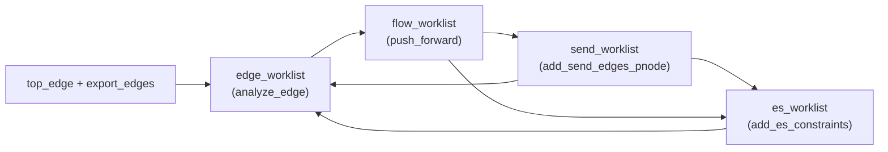
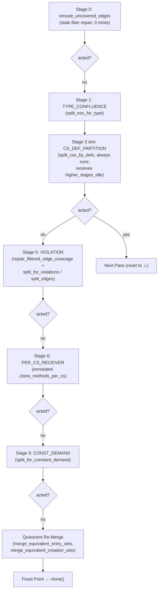

# Demand-Driven Iterative Flow Analysis: Thirty Years On

**Minimal Contours, Provenance-Free Identity, and Unified Data Splitting for Static Compilation of Python**

*A technical successor to Plevyak & Chien, "Iterative Flow Analysis" (OOPSLA '94 / [ifa-submit.pdf](../ifa-submit.pdf)), documenting the flow-analysis algorithm implemented in `ifa/analysis/` as of `pyc` v0.3.0 (November 2026).*

---

## Abstract

In 1994, Plevyak and Chien introduced *Iterative Flow Analysis* (IFA), a simultaneous control- and data-flow analysis that starts from a minimal abstract contour representation and iteratively refines both function and object contours until type checks and dynamic dispatches are resolved. That original formulation was evaluated on nine Concurrent Aggregates programs of up to 2,000 lines. Over the past several years, the IFA engine has been adapted to compile full Python 3 programs to unboxed native C and LLVM code (`pyc`), exercising the algorithm against mutable generic containers, first-class closures, iterators, generators, dynamic attribute creation, and a 77-program real-world benchmark corpus (Shedskin's examples).

This experience exposed four structural weaknesses in the 1994 design: (1) asymmetric initialization that started function contours minimal while fragmenting data contours by allocation site; (2) provenance embedded in contour identity (mark distances, lexical displays, and per-site tags); (3) fact-driven data splitting (`SETTER` / `SETTER_OF_SETTER`), which partitioned contours whenever two writers disagreed rather than when an operation could not proceed; and (4) cross-pass routing instability causing oscillation under iterative re-derivation.

We present the current IFA algorithm that resolves all four. Both function contours (`EntrySet`) and data contours (`CreationSet`) now start minimal and split *strictly on demand*, evaluated at intra-pass quiescence. Contour identity keys exclusively on deduced types, CreationSet partitioning, and target-language representability—never on provenance. All mark-based stages, Cartesian-product fans, and the entire `SETTER` / `SETTER_OF_SETTER` machinery have been retired; data splitting is unified into a single demand-driven partitioner (`CS_DEF_PARTITION`) backed by call-context-matched backward heap walks, an idempotent cross-pass split ledger, and quiescent contour re-merging. Across the 77-program Shedskin corpus, the analysis compiles 77/77 programs in 126.7 s (8-way parallel) with zero runtime boxing, reduces total EntrySets and CreationSets relative to the setter-based baseline, eliminates layout over-splitting (e.g., collapsing `go`'s `UCTNode` to a single struct layout), and passes all 613 end-to-end tests on both C and LLVM backends.

---

## 1. Introduction

Optimizing and statically compiling dynamically typed, object-oriented languages requires knowing concrete types at every operation and call site. Because object types govern dynamic dispatch and dispatched methods produce new object types, control flow and data flow are mutually dependent and must be solved simultaneously. Fixed-precision analyses such as $k$-CFA [Shivers 1991] and Oxhøj–Palsberg–Schwartzbach (OPS) [Oxhøj et al. 1992] pre-commit to a uniform contour depth across the entire program, spending excessive memory where code is monomorphic while still failing where polymorphism exceeds $k$.

*Iterative Flow Analysis* (IFA) [Plevyak & Chien 1994, `ifa-submit.pdf`] addressed this by starting from a coarse 0-CFA-like contour representation and iteratively *splitting* function contours and object contours only where imprecision was observed. On Concurrent Aggregates (CA), IFA typed all nine benchmark programs (39–1,934 lines) and statically bound over 99% of dynamic invocations while using 1.5–2.5 contours per method.

Applying IFA to **Python 3** in `pyc`—with the contract of compiling well-formed CPython programs with *identical CPython semantics* to unboxed native code—pushed the algorithm far beyond its 1994 testbed. Python programs routinely route heterogeneous values through shared library factories (`list.__mul__`, `enumerate`, `dict`, `defaultdict`, `heapq`, `itertools`), mutate attributes dynamically after construction, pass closures and bound methods as first-class values, mix `int` and `float` or `None` and scalars in records, and exhibit deep polymorphism across standard-library iterators.

Under this workload, four latent defects in the 1994 formulation became first-order failures:

1. **Asymmetric minimal start.** Function contours (`EntrySet`) started at one per function, but object contours (`CreationSet`) were memoized per *(allocation site × enclosing contour)*. Whenever a function split, every allocation inside it minted a new `CreationSet` unconditionally—producing, for example, 95 list contours for 6 distinct element types on `chess` (`ifa/128`).
2. **Provenance in contour identity.** The 1994 algorithm and its early C++ implementation encoded *where a value came from*—distance marks (`mark_map`), lexical scope displays (`EntrySet::display`), and allocation-site IDs—into contour compatibility and splitting keys. Provenance cannot be named by a type tuple, fragments equivalent contours across passes, and causes non-monotone contour blowups.
3. **Fact-driven data splitting.** The original paper's §5.4 data-splitting mechanism (`SETTER` and `SETTER_OF_SETTER`, implemented via `AVar::setters` and `setter_class`) nominated a split whenever two writers to a member differed. A union of two writers is a *fact* about the program, not a *demand*; splitting on facts inflated record layouts (e.g., splitting `UCTNode` in `go` into multiple incompatible structs), caused 40+ zero-violation passes on `re`, and fought contour re-merging into pass-cap loops.
4. **Cross-pass routing instability.** Because each pass resets derived types to $\bot$ and re-derives flow from scratch, non-idempotent split decisions re-minted contours on every pass, causing period-2 oscillations and superlinear compile-time blowups.

This paper describes the successor IFA algorithm that now powers `pyc` (v0.3.0). Section 2 formalizes the three governing invariants (demand-only splitting, provenance-free identity, and quiescence). Section 3 defines the IR and abstract domain. Section 4 details the intra-pass fixed-point solver and phased outer loop. Section 5 presents the unified refinement pipeline, including the demand-driven `CreationSet` partitioner and call-context-matched heap walk that replace Stage 3 (`SETTER`). Section 6 covers convergence, the split ledger, recursion, and the empirical deletion of six legacy mechanisms. Section 7 summarizes the interface to type-directed cloning and code generation. Section 8 reports empirical results across the 77-program corpus and 655-test suite. Sections 9 and 10 discuss related work, open problems, and conclusions.

---

## 2. Governing Principles: Demand, Identity, and Quiescence

Modern IFA is organized around three strict invariants, each validated by same-binary ablation sweeps across the Shedskin corpus (`ifa/146`, `ifa/157`, `ifa/196`):

### 2.1 Demand-Only Splitting

> **Invariant 1 (No Structural Splitting).** *A contour—`EntrySet` or `CreationSet`—is never split merely because a surrounding contour split, or because a union exists. Splitting occurs only when an operation observes a distinction it cannot proceed on.*

Every proposed splitting rule must pass a **two-question test**:
1. *What observed the distinction?* Legitimate demands are: an irrepresentable type union (mixed basic types, `{None, scalar}`, mixed-arity fixed tuples), an unresolved multi-function dispatch (receiver or callee union reaching $\ge 2$ functions), a numeric int/float mix that would force permissive widening, or an outstanding `ATypeViolation`.
2. *Can the proposed partition change that observation?* Splitting a contour whose creation points all write the same union, or splitting a method on a non-receiver argument that a single-dispatch method slot cannot distinguish at run time, fails this test.

The dependency between function and data contours runs one way: an `EntrySet` may be split *as a means* so that creation points separate and a demanded `CreationSet` split becomes possible; an `EntrySet` split never *causes* a `CreationSet` split.

### 2.2 Provenance-Free Contour Identity

> **Invariant 2 (Types and Representability Only).** *Contour identity keys exclusively on deduced types, `CreationSet` partitioning, and target-language representability—never on provenance.*

Every candidate key falls into one of three categories:
- **What the deduced types are** (argument `AType`s, content-channel `AType`s): *permitted*.
- **What the target language can represent** (fixed tuple arity `static_arity`, member width, `None` beside an unboxed scalar): *permitted* (`ifa/132`).
- **Where the value came from** (allocation site ID, lexical display chain, mark distance from a generating `AVar`, module/file of origin, per-write provenance tags): *forbidden*.

A corollary governs early-pass merges: if a transient merge cannot be undone by provenance, the remedy is not to record provenance, but to split coarser on demand and re-derive from $\bot$—or to retire superfluous contours at quiescence (§5.6).

### 2.3 Evaluation at Quiescence

> **Invariant 3 (Level-Triggered Demand at Quiescence).** *Every demand predicate is evaluated on the converged fixed point of the current pass, never on transient events while a union is forming.*

In `analyze_to_convergence`, every intra-pass worklist drains completely before any split stage runs. The `!analyze_again` gate between stages is a *cascade gate* (prioritizing cheaper/finer stages first), not a quiescence gate: the outer loop terminates only on a pass where *no* stage acts, so every gated stage is guaranteed to observe the final converged state (`ifa/157`).

### 2.4 Summary of Changes from 1994 IFA (`ifa-submit.pdf`)

| Dimension | 1994 Concert IFA (`ifa-submit.pdf`) | 2026 `pyc` IFA (`ifa/analysis/`) |
|---|---|---|
| **Initial `EntrySet`s** | 1 per function (0-CFA) | 1 per function (0-CFA) |
| **Initial `CreationSet`s** | Per creation point / eager | Minimal: 1 per class `Sym` (`PYC_CSDCPA1=2`), arity-keyed for tuples; parent-first child reuse |
| **Contour Identity** | Callers $I$, restrictions $R$, display, marks | Deduced types, CS partitioning, representability; display and marks removed |
| **Flow Narrowing** | Static `restrict` sets | Dynamic `AVarRestrictPred` (`is None`, `isinstance`) re-evaluated as types grow |
| **Data Splitting** | Fact-driven `AssignSets` / `Path(a)` (`SETTER`, `SETTER_OF_SETTER`) | Unified demand-driven `CS_DEF_PARTITION` (Route 4) in Stage 3's slot; `SETTER` retired |
| **Data-Flow Walk** | Unmatched backward closure `Closure(Back, Self(a))` | Call-context-matched walk (`callctx_step`, `heap_pts`) tracking allocation contexts across nested containers |
| **Recursion Control** | SCC exclusion + 2-level peeling | SCC gating (`is_es_recursive`) + demand-conditioned unpeeling for single-def containers; mark stages deleted |
| **Cross-Pass Stability** | Ad-hoc contour reuse | Persistent `split_ledger` + `group_signature` + self-product complement eviction + quiescent re-merge |
| **Intra-Pass Flow** | Immediate recursive propagation | Deferred `flow_worklist` batched ahead of `send_worklist` |
| **Target & Scale** | 9 CA programs ($\le 1{,}934$ LOC) | 77 Python 3 corpus programs + 655 e2e tests; C & LLVM unboxed backends |

---

## 3. Program Representation and Abstract Domain

### 3.1 IF1 and Static Single Use (SSU) Form

Frontends (the `pyc` Python 3 compiler or the standalone `ifa` V-language driver) lower source programs into **IF1**: a CFG of `PNode`s (moves, sends, conditionals, labels, gotos, $\phi$-nodes, and $\psi$-nodes) operating on `Var`s inside `Fun`s. Before analysis begins, `Fun` bodies are converted to **Static Single Use (SSU)** form (`ifa/optimize/ssu.cc`), inserting $\phi$-nodes at control-flow joins and $\psi$-nodes at branches so that distinct uses of a variable along different control paths receive distinct `Var`s and do not interfere in transfer functions (preserving the 1994 paper's §3 design).

### 3.2 Abstract Domain and Hash-Consed Lattice

The flow graph is defined over four primary entities (`ifa/analysis/fa.h`):

$$\begin{aligned}
c &\in \text{Contour} = \text{EntrySet} \;\cup\; \text{CreationSet} \;\cup\; \{\text{GLOBAL\_CONTOUR}\} \\
a &\in \text{AVar} = \text{Var} \times \text{Contour} \\
\tau &\in \text{AType} = \mathcal{P}_{\text{fin}}(\text{CreationSet}) \\
e &\in \text{AEdge} = \text{EntrySet} \times \text{PNode} \times \text{Match} \times \text{EntrySet}
\end{aligned}$$

- **`CreationSet` (CS).** Represents an abstract equivalence class of allocated objects of class `sym`. It owns its member `AVar`s (`vars`, `var_map`), an optional container element `AVar` (`sym->element`), its set of allocating `AVar`s (`defs`), and representability metadata (`static_arity`, `no_static_arity`, `tuple_able`, `clone_for_constants`). Every class symbol also has a distinguished *abstract* `CreationSet` (`sym->abstract_type->v[0]`). Concrete vs. abstract classification uses `cs_is_concrete(cs)` (`cs != cs->sym->abstract_type->v[0]`), never transient `cs->defs.n`, so unreached concrete contours in `EntrySet::filters` are never misclassified as abstract class types during lattice intersection (`ifa/196`).
- **`EntrySet` (ES).** Represents an abstract calling environment of a `Fun`. It holds positional argument/return `AVar`s (`args`, `rets`), per-position `AType*` dispatch filters (`filters`), incoming `AEdge`s (`edges`), outgoing calls (`out_edges`, `out_edge_map`), allocated `CreationSet`s (`creates`), and a lexical `display` used *solely* for enclosing-scope `Var` resolution—explicitly excluded from contour identity (`ifa/100`).
- **`AType`.** A canonicalized, hash-consed set of `CreationSet*` stored in `TypeWorld::cannonical_atypes`, so pointer equality is semantic equality. `AType` carries memoized `union_map`, `intersection_map`, and `diff_map`, plus a constant-stripped projection `AType::type` (which retains `sym_nil_type` so `None` stores are never conflated with bottom, `ifa/178`). Constants are widened to their base type once a variable exceeds `num_constants_per_variable` (default 1).
- **`AVar`.** The flow node for `(Var, Contour)`, storing `gen`, `in`, `out = in \cap restrict`, `forward`/`backward` flow edges, `container` back-pointers for member/element writes, `cs_map` (its per-symbol `CreationSet` assignment), and optional `num_coerce` (permissive numeric widening). Narrowing predicates (`RP_IsNilType`, `RP_IsNotNilType`, `RP_IsInstanceOf`, `RP_NotInstanceOf`) re-evaluate dynamically as new `CreationSet`s arrive at `in`, avoiding stale snapshot restrictions (`ifa/026`).

### 3.3 Minimal Initialization on Both Sides

On pass 0, every reachable function starts with a single `EntrySet`. Every allocation site calls `creation_point(v, sym, n)`:
- If `v->cs_map` already records a `CreationSet` for `sym` (from a prior pass's split decision), that decision is reused.
- Otherwise, under `PYC_CSPARENTFIRST=1` (default), if `v`'s enclosing `EntrySet` was split from a parent `EntrySet`, `v` joins its parent's `CreationSet` rather than minting a new one.
- Otherwise, under `PYC_CSDCPA1=2` (default), all allocations of `sym` join the single canonical start-merged `CreationSet` for `sym` (partitioned by `static_arity` for fixed-size tuples, since arity is part of tuple representation).

Thus both function and data contours begin minimal; every additional contour must be earned by a demand.

---

## 4. The Intra-Pass Solver and Phased Outer Loop

### 4.1 Per-Pass Reset and Decision Persistence

At the start of every pass after pass 0, `analyze_to_convergence` calls `clear_results()` (or `clear_results_selective()` when selective invalidation is enabled), resetting every `AVar`'s `gen`, `in`, `out`, `forward`, `backward`, and `arg_of_send` to $\bot$ and clearing `type_violations`. What **persists** across passes are exclusively the *contour decisions*:
1. Each allocating `AVar`'s `CreationSet` binding (`av->cs_map`).
2. Each `AEdge`'s target `EntrySet` binding (`e->to`) and each `EntrySet`'s `filters`.
3. The cross-pass `split_ledger` and `overwritten_stores` / `num_coerce` annotations.

Resetting derived types before every pass guarantees that splitting can *shrink* types (which a monotone intra-pass solver cannot do on its own) and that the final converged state remains intact for cloning and codegen when the outer loop exits (`ifa/098`).

### 4.2 Four-Queue Deferred Fixed-Point Loop

Within each pass, `FA::analyze` drains four worklists until all are empty (`fa.cc:13638`):
1. **`edge_worklist` (`analyze_edge`).** Binds or re-binds `AEdge`s to target `EntrySet`s via `make_entry_set`, applies `formal_filters` and `es->filters` through per-edge `filtered_args` AVars, wires argument/return flow, and enqueues newly reached `EntrySet`s.
2. **`flow_worklist` (`push_forward`).** With `defer_flow = true` (`ifa/186`), `update_in` queues any `AVar` whose `out` grew rather than recursively pushing immediately. Draining `flow_worklist` in batch ahead of `send_worklist` collapses cascading union updates: on `othello3` pass 1, this cut `out`-change propagations from **105M to 1.85M**.
3. **`send_worklist` (`add_send_edges_pnode`).** Evaluates primitive transfer functions (member loads/stores `P_prim_period`/`P_prim_setter`, indexing, cloning, constant-folding arithmetic, `isinstance`) and non-primitive calls via `pattern_match` (with `MatchCache` keyed on the arity epoch, `ifa/197`).
4. **`es_worklist` (`add_es_constraints`).** Re-scans an `EntrySet`'s live `PNode`s when a conditional predicate (`is_if_arg`) changes, enabling dead-branch elimination during flow analysis.

Once all four queues are empty, `complete_pass()` collects `ATypeViolation`s (`PRIMITIVE_ARGUMENT`, `SEND_ARGUMENT`, `DISPATCH_AMBIGUITY`, `MEMBER`, `MATCH`, `NOTYPE`, `BOXING`, `CLOSURE_RECURSION`) and `compute_es_can_raise()` updates exception-flow summaries.

### 4.3 The Phased Outer Loop

Because Python allows late structural discoveries (such as an attribute assigned to `self.x` outside `__init__`), `analyze_to_convergence` orders frontend callbacks and splitting into a strict hierarchy (`fa.cc:13710`):

1. **Phase 1 — Structural Frontend Repair (`reanalyze`, phase 1).** Dynamic field promotion and structural IR repairs run to a fixed point *before* splitting, preventing late field discoveries from perturbing settled contours (`ifa/055`, which lifted corpus compilation from 67/77 to 71/77).
2. **Phase 2 — Iterative Contour Refinement (`extend_analysis`).** Runs the demand-driven split stages (§5).
3. **Phase 3 — Type-Reading Frontend Repair (`reanalyze`, phase 2).** Only after splitting quiesces: permissive numeric coercion (`fa_coerce_numeric_confluences`, off under `--strict`) and late type-reading callbacks.
4. **Phase 4 — Quiescent Cleanups.** Unbound-variable fills (`apply_unbound_fills`), retraction of unused promoted fields (`retract_derived_state`), and dominated `None`-overwrite elimination (`decide_overwritten_stores`, `ifa/191`).
5. **Mid-FA Inlining (`ifa_fa_inline`).** After first full convergence, `simple_inlining` folds identity wrappers (e.g., specialized `__pyc_to_bool__`), clears per-ES `live_pnodes`, and runs a second `analyze_to_convergence` over the cleaner IR.

---

## 5. Demand-Driven Refinement (`extend_analysis`)

When Phase 1 is idle, `run_split_stages()` executes the active refinement stages in priority order. Each stage reads the converged pass state and returns `1` if it changed any contour or edge binding.

### 5.1 Stage 0: Stale-Edge Rerouting (`reroute_uncovered_edges`)

When an upstream `CreationSet` splits, an already-filtered `AEdge` whose target `EntrySet::filters` named only the old `CreationSet` can silently drop the new one. Stage 0 detects edges whose actuals contain valid `CreationSet`s not covered by `e->to->filters`, detaches them, and forces a re-route on the next pass without minting any contours.

### 5.2 Stage 1: Type-Confluence Function Splitting (`TYPE_CONFLUENCE`)

`collect_type_confluences` identifies `EntrySet`-contoured `AVar`s where distinct incoming `AEdge`s deliver different base types (`AVar::out->type`). For each confluence, `decide_entry_set_split` partitions incoming edges into mutually type-compatible groups (`edge_type_compatible_with_edge`) and `apply_entry_set_split` routes each non-staying group through the **split ledger** (§6.1) to a durable product `EntrySet`.

Recursive edges (`is_es_recursive`) are gated unless their argument types are disjoint from all other callers' types—or unless the contour owns the sole creation point (`defs == 1`) of a `CreationSet` whose element union is irrepresentable (e.g., `list.__deepcopy__`'s `r = []`, `ifa/168`).

### 5.3 Stage 3 Slot: Unified Demand-Driven Data Splitting (`CS_DEF_PARTITION`)

`split_css_by_defs(bool higher_stages_idle)` occupies Stage 3's slot—running *before* Stage 5 (`VIOLATION`) so that data-contour unions are resolved before violation splitting shreds callers on transient mixed types (`ifa/196`). It is the sole `CreationSet` splitter in the compiler.

#### Demand Identification

A `CreationSet` $C$ is nominated only if it carries an observable demand:
1. **Irrepresentable content (`elem_irrepresentable`, `member_irrep_or_dispatch`).** $C$'s element channel or (at `higher_stages_idle`) any member in `C->vars` holds mixed basic types, `{None, scalar}`, mixed-arity fixed tuples, or a union of $\ge 2$ container `CreationSet`s whose combined element types trigger a dispatch demand.
2. **Unresolved dispatch (`sos_dispatch_demanded`).** A content channel holds $\ge 2$ non-`None` receiver `CreationSet`s of a multi-function send that reach *distinct* target function sets (`sos_poly_tsig`), or $\ge 2$ distinct callees of a multi-function call (`sos_poly_callees`, e.g., closure-captured functions).
3. **Numeric mix (`cs_numeric_mix_content`).** A channel mixes `int` and `float` (which would otherwise force permissive widening).
4. **Violation backward reach (`viol_reach`).** At `higher_stages_idle`, any `CreationSet` whose content lies on the backward flow reach (following `backward` and `container` links) of an outstanding `ATypeViolation`.

#### Matched-Call-Context Flow Graph (`build_cs_flow_graph_over`)

In 1994 IFA (§5.4), data splitting computed `Path(a) = Closure(Back, Self(a))` over the raw backward graph. In Python, where two unrelated containers pass through shared helpers (`list.append`, `enumerate`, `dict.__setitem__`, `__list_iter__.__next__`), an unmatched backward walk exits every helper into *all* callers, collapsing distinct objects onto identical signatures.

Modern IFA replaces this with a **call-context-matched backward walk** (`callctx_step` and `heap_pts`, `ifa/156`, `ifa/196`):
- Walk states are pairs `(AVar *a, CallCtx *c)`, where `CallCtx` is either a call-edge stack frame (`e`, pushed when entering a callee's return and popped only through the matching call edge `e`), a `CONTENT` frame carrying the bounded set of heap objects `ObjVec` (`(def_av, alloc_ctx)` pairs from `heap_pts`), or a `RECEIVER` frame (`recv_cs`, `recv`, `objs`).
- Stepping out of a container's content into a writer resumes the allocation context if the writer allocated the container locally, or carries a `RECEIVER` frame whose exit is restricted to callers whose actual can hold a compatible `(def, ctx)` pair (`objs_share_def` with prefix-compatible call stacks `callctx_compatible`).
- When a `RECEIVER` frame exits a factory contour that allocated the object internally (`!pos.n`, such as `enumerate(seq)`), `callctx_step` constrains the exit to call edges matching `c->objs`'s call-context chain; and when stepping from a filtered argument through a bound-method `sym_closure` `CreationSet` back into its caller contour, the caller's active call-edge frame is preserved.

#### Actuators

Given a demanded `CreationSet` $C$ and its assign-set flow graph $G$, `split_css_by_defs` applies the minimal actuator that can separate the conflicting writes:

1. **Multi-def assign-set partitioning (`defs >= 2`).** Each creation point $d \in C.\text{defs}$ is keyed by the subset of assign-set keys (written types) whose backward paths reach $d$ (using `kCallMatchNumeric` over the demanded channels when `by_numeric` or `DEMAND-MATCH-KEY` applies). If $\ge 2$ groups emerge, group 0 keeps $C$ and each other group receives one new `CreationSet` via `d->cs_map->put(C->sym, ncs)`.
2. **Blocking `EntrySet` split (`find_blocking_es` / `split_blocking_es`).** When $C$ has `defs >= 2` but all creation points share one signature because a single merged helper contour (e.g., `list.append`) fuses their paths, Route 4 splits that blocking `EntrySet` so the next pass separates the paths.
3. **Parent-first join undo (`JOINSPLIT`, `ifa/176`).** When all `defs` are the *same* `Var` in distinct already-split contours of one function (shared only because of `PYC_CSPARENTFIRST=1`), each contour receives its own `CreationSet`.
4. **Owner-chain splitting (`CSOWNER`, `split_owner_of_demanded`).** When $C$'s writes flow through an enclosing owner container/record (e.g., `dict._keys` inside `dict`, or `Box` inside `Holder`), `CSOWNER` climbs to the owner `CreationSet` and partitions it by its flat member types—falling back to `(type, member-slot)` pairs for symmetric swapped-type owners (e.g., `dict[str, int]` vs. `dict[int, str]`), and climbing `defs == 1` owner factories at `higher_stages_idle`.
5. **Single-def factory climb (`es_climb_to_choice` + `split_es_by_call_site`).** When $C$ has `defs == 1` (e.g., `list.__mul__`, `enumerate`, or a user factory), Route 4 climbs from `d`'s contour up the call graph to the first ancestor `EntrySet` with $\ge 2$ call sites and splits that `EntrySet` by assign-set key.
6. **Untagged dispatch separation (`UNTAGGED_DISPATCH`).** At `higher_stages_idle`, separates callers of a single function whose return type mixes incompatible untagged contours.

### 5.4 Stage 5: Violation-Driven Dispatch Splitting (`VIOLATION`)

When Stages 0–3 are idle and `type_violations` is non-empty, `split_for_violations` first runs `repair_filtered_edge_coverage()` to widen same-sym untagged filters or add missing filtered edges for valid `CreationSet`s accepted by `e->match->formal_filters` but uncovered by `e->to->filters`. It then traces remaining violations backward (`collect_violation_imprecisions`), filters out `Var`s that have exceeded `PYC_VIOLATTEMPTS` (default 2 *futile* attempts—reset whenever a split narrows the violating span), and runs `split_ess_for_type(..., SPLIT_DYNAMIC)`.

Dynamic splitting invokes `split_edges(av)` on a formal whose type spans multiple `CreationSet`s at a single call site:
- **Bounded 2-group splitting (`ifa/146`).** Instead of fanning $k$ `CreationSet`s into $k$ contours in one pass, `split_edges` separates the first `CreationSet` from the remaining $k-1$ (letting `None` ride in pointer parts when no caller passes `{None}` alone). Target `EntrySet`s are deduplicated (`if (!targets.in(tes)) targets.add(tes);`), preventing an $O(n!)$ duplicate-`AEdge` blowup on repeated 2-group splits.
- **Dispatchability guards.** `split_edges` declines when all `CreationSet`s have identical slot signatures (`cs_slot_sig_equal`, differing only in constants—leaving those to `CONST_DEMAND`), and declines splitting a *non-receiver* formal of a method across same-class clones (e.g., `V_int` vs. `V_float`), because a single-dispatch method slot cannot dispatch on a non-receiver argument; keeping the union on the formal lets codegen emit a sound tag-checked field read (`ifa/206`).

### 5.5 Stages 6 & 9: Annotated Receiver Splitting and Constant Demand

- **Stage 6 (`PER_CS_RECEIVER`).** Separates methods of classes explicitly marked `clone_methods_per_cs` (9 remaining frontend annotations tracked for removal in `ifa/134`).
- **Stage 9 (`CONST_DEMAND`, `ifa/151`).** Runs only when the entire type ladder is idle and violations persist; separates call edges on constant values (such as a tuple index or format string) that fold a branch or resolve a heterogeneous tuple lookup.

### 5.6 Quiescent Contour Re-Merge (`ifa/170`)

On a pass where no split stage acted and `type_violations` is empty, `merge_equivalent_entry_sets()` (enabled by default) and `merge_equivalent_creation_sets()` (`PYC_CSMERGE=1`) collapse contours of the same function or class whose converged `AVar` states are identical (and not coerced, demanded, or freshly asserted by the split ledger on this pass). This reclaims contours minted on transient early-pass types without needing to predict at split time whether a distinction will survive.

---

## 6. Convergence, Stability, and Lessons from Retired Mechanisms

### 6.1 The Split Ledger

Without cross-pass memory, splitting an `EntrySet` on pass $p$ can detach an edge that pass $p+1$ re-groups identically, minting a fresh `EntrySet` every pass. `FA::split_ledger` records each split decision keyed by `(source_es, position, group_signature)`—a hash of the constant-stripped argument types of the moved edge group. On subsequent passes:
- A re-derived group is routed into its recorded `product` rather than minting a new contour (preserving `es_preserves_filters` so filters are never silently dropped, `ifa/196`).
- If a group's recorded home is the contour being split itself (*self-product*), `apply_entry_set_split` evicts the compatible complement (`stay_edges`) once instead of detaching the home group forever (`ifa/074`).

### 6.2 Stall Guard and Hard Pass Cap

`extend_analysis` enforces termination via two guards:
- **Dup-aware stall guard.** Tracks `best_violations`. Passes with `v > 0` that do not improve `best_violations` increment `nonimprove_passes` (and `stall_passes` only when `rederive_churn > 0`, distinguishing genuine structural descent from oscillation). Zero-violation passes that re-derive splits without growing `ess`/`css` increment `zero_viol_stall_passes`. Once tripped, the guard is sticky until `reanalyze` strictly improves violations or clears them to zero.
- **Hard pass cap (`IFA_PASS_LIMIT = 100`).** Unconditionally bounds the entire outer loop and sets `FA::pass_limit_hit` so downstream consumers know whether the violations are a converged diagnosis or a mid-iteration snapshot.

### 6.3 Six Historical Mechanisms Deleted (With Measurements)

A central methodological discipline in this codebase is *delete, do not default off* (`ifa/146`). Every mechanism below was measured on the full 77-program corpus and deleted:

| Retired Mechanism | Why It Violated Principles | Measured Effect of Removal |
|---|---|---|
| **Lexical display in contour identity** (`ifa/100`) | Provenance (where a closure was lexically defined) | −40% to −80% contours corpus-wide |
| **`PYC_CSSPLIT=1`** (`ifa/146 A`) | Structural splitting (CS followed every ES split) | Eliminated unconditional CS multiplication |
| **`MARK_TYPE`** (`ifa/146 D`) | Provenance (depth-from-generating-AVar) | Guard trips 18 → 10, −55% analysis time, −12.3% contours |
| **`MARK_SETTER` / `MARK_SETTER_OF_SETTER`** (`ifa/146 D`) | Provenance (marked setter distance) | −7.0% ES, −6.9% CS, −12% compile wall; `plcfrs` 94 → 67 passes |
| **`CARTESIAN_PRODUCT`** (`ifa/146 E`) & **`CSM_ELEMENT_CS`** (`ifa/146`) | Fact-driven fan (no demand test) | Non-monotone (forced on, `CSM` took errors 0 → 9) |
| **`SETTER` / `SETTER_OF_SETTER`** (`ifa/196`) | Fact-driven nomination (`AVar::setters` / `setter_class`) | −0.9% ES, −0.4% CS, −2 warnings; `go` 1 `UCTNode` layout; `re` 11–14 passes; −1,060 LOC |

---

## 7. Interface to Cloning, Semantics, and Code Generation

When `FA::analyze` reaches a fixed point, `clone.cc` (based on Plevyak & Chien's LCPC '95 type-directed cloning) partitions equivalent `EntrySet`s and `CreationSet`s into concrete functions and struct layouts, synthesizing `Type_SUM` unions only where polymorphism genuinely survives.

Two semantic invariants bridge IFA and codegen in `pyc`:
1. **Strict CPython semantics vs. flagged accommodations (`issues/171`).** Every semantic deviation from CPython 3—such as permissive `int`/`float` widening—is off under `--strict`, emits a warning under `--permissive`, and reaches generic `ifa/` code solely through `IFACallbacks`.
2. **Layout-contract verification and tag-checked union reads (`ifa/206`).** Codegen records every blind cast between struct layouts and refuses any field read where member offsets or scalar/float representations disagree. When a `Type_SUM` union holds clones of one class with incompatible field layouts (e.g., `V_int` vs. `V_float`), `cg_plan_concrete_tags` assigns distinct runtime tags to the disagreeing clones and `cg_union_read_arms` emits a tag-checked read on both C and LLVM backends.

---

## 8. Empirical Evaluation

All measurements below were taken on `pyc` v0.3.0 (`e6864904` / `0a461073`, Apple Silicon, Clang/LLVM, `OPTIMIZE=1`) across the **77-program Shedskin Python benchmark corpus** (`shedskin_examples/`) and the **655-test end-to-end suite** (`tests/`).

### 8.1 Test Suite and IR Phase Coverage

- **IFA unit tests (`ifa --test`):** 58 passed, 0 failed.
- **IR phase golden tests (`ifa-test`):** 17 phases (`finalize`, `cfg`, `ssu`, `dom`, `loops`, `argpos`, `patterns`, `fa-init`, `dispatch`, `clone`, `dce`, `freq`, `codegen-c`, `codegen-llvm`, `inline`, `escape`, `fa-converge`), 0 failed.
- **End-to-end Python suite (`test_pyc.py`):** 613 passed on Linux CI (601 passed + 12 macOS-environment skips locally), 11 expected-fail refusal tests, 18 filed `.known_issue` tests, 0 regressions on both C and LLVM backends.

### 8.2 Corpus-Wide Comparison: Retiring Stage 3 (`SETTER`)

Comparing `pyc` v0.3.0 (Stage 3 retired; Route 4 in Stage 3's slot) against the immediate pre-retirement baseline (`sweeps/check__PYC_SOSTARGETS_2__799183aa+7174753f.tsv`, which still ran `SETTER` and `SETTER_OF_SETTER`):

| Metric (77 Shedskin Programs) | Pre-Retirement (`SETTER` on) | v0.3.0 (Stage 3 Retired) | Delta |
|---|---:|---:|---:|
| Programs compiled | 77 / 77 | **77 / 77** | 0 |
| Total `EntrySet`s (`ess`) | 36,506 | **36,181** | **−0.9%** |
| Total `CreationSet`s (`css`) | 149,745 | **149,119** | **−0.4%** |
| Container `CreationSet`s / shapes | 3,072 / 882 (3.48) | 3,085 / 881 (3.50) | +0.4% |
| Permissive warnings | 65 | **63** | **−2** (`fysphun` 6 → 4) |
| Total compile wall time (8-way) | — | **126.7 s** | — |

### 8.3 Targeted Benchmarks and Structural Outcomes

| Program | Pre-Retirement Behavior | v0.3.0 Behavior |
|---|---|---|
| `go` | 2+ `UCTNode` layouts; 6 `--refuse-imprecise` sites | **1 `UCTNode` layout** (`_CG_type_UCTNode_57051`); 2 `--refuse-imprecise` sites (0 `UCTNode`) |
| `re_syntax` / `re_find_sub` / `re_search` | 40+ pass zero-violation `SETTER` tail | **11–14 passes** |
| `softrender` | Hit >180 s timeout after 2-group `split_edges` duplicate-edge blowup | **7.6 s** compile time; 0 `ifa/121` warnings |
| `othello3` | Largest corpus program (>400 s before deferred flow) | **107.3 s** (`ess=4,885`, `css=11,907`) |
| `sunfish` | Chess engine with mixed-arity tuples & iterators | **38.4 s** (`ess=958`, `css=4,790`) |
| `plcfrs` | Symmetric swapped-type dicts (`dict[str, int]` / `dict[int, str]`) | **32.0 s** (`ess=1,249`, `css=3,536`) |
| `voronoi` (`PYC_CSMERGE=1`) | Hit 101-pass cap fighting `SETTER` | **Converges in 14 passes** |

---

## 9. Related Work and Open Problems

**Related work.** Beyond the 1994 paper's discussion of $k$-CFA [Shivers 1991], OPS [Oxhøj et al. 1992], Agesen's Cartesian Product Algorithm [Agesen 1995], and SELF's iterative type analysis [Chambers & Ungar 1990], the closest modern point of comparison for Python is **Shedskin** [Dufour 2006], which compiles the same 77-program benchmark corpus to C++ using an iterative Cartesian-product / template-instantiation type inferencer. `pyc` adopts Shedskin's route-4 conceptual framing (partitioning allocation sites by assign-set signatures when finer function splits decline) while differing in two key respects: (1) `pyc` enforces CPython 3 semantics under `--strict` rather than adopting C++-convenient deviations (e.g., `math.floor` returning `int`, not `float`), and (2) `pyc` starts minimal on both function and data contours without pre-allocating per-site templates. RPython [Bolz et al. 2009] performs abstract interpretation over a restricted Python subset with programmer-enforced monomorphism; Codon [Shajii et al. 2023] uses bidirectional Hindley–Milner-style instantiation rather than iterative whole-program flow refinement.

**Open problems.** Four well-scoped problems remain in `ifa/issues/`:
1. **Eliminating the last 9 frontend-annotated splits** (`ifa/134`), allowing Stage 6 (`PER_CS_RECEIVER`) to be retired as well.
2. **Enabling `CreationSet` re-merging (`PYC_CSMERGE=1`) by default** (`ifa/170` step 3): retiring Stage 3 unblocked `voronoi` (101 → 14 passes), leaving one non-setter loop on `bh` to diagnose.
3. **Empty-container dead loops** (`ifa/072`): loops iterating over provably empty containers currently type-check their bodies against $\bot$.
4. **Selective intra-pass invalidation** (`ifa/111`): `clear_results_selective()` is implemented behind `IFA_SELECTIVE=1` and now free of `setter_class` invariants; measuring and enabling it by default can cut multi-pass compile times on large programs like `othello3`.

---

## 10. Conclusion

Thirty years after its original publication, Iterative Flow Analysis remains uniquely well suited to statically compiling dynamically typed, object-oriented languages—provided its founding premise is applied symmetrically and without compromise. Starting minimal on *both* function and data contours, banishing provenance from contour identity, evaluating all demand at quiescence, and replacing fact-driven setter splitting with a single call-context-matched demand partitioner yields an analysis that is simultaneously simpler (−1,060 lines of legacy setter machinery removed), more predictable, and strong enough to compile all 77 programs of the Shedskin Python benchmark corpus to unboxed native code.

---

## References

- **[Agesen 1995]** O. Agesen. *The Cartesian Product Algorithm: Simple and Precise Type Inference of Parametric Polymorphism*. ECOOP '95, 1995.
- **[Bolz et al. 2009]** C. F. Bolz, A. Cuni, M. Fijalkowski, and A. Rigo. *Tracing the Meta-Level: PyPy's Tracing JIT Compiler*. ICOOOLPS '09, 2009.
- **[Chambers & Ungar 1990]** C. Chambers and D. Ungar. *Iterative Type Analysis and Extended Message Splitting*. PLDI '90, 1990.
- **[Dufour 2006]** M. Dufour. *Shed Skin: An Optimizing Python-to-C++ Compiler*. Master's thesis, Delft University of Technology, 2006.
- **[Oxhøj et al. 1992]** N. Oxhøj, J. Palsberg, and M. I. Schwartzbach. *Making Type Inference Practical*. ECOOP '92, 1992.
- **[Plevyak & Chien 1994]** J. Plevyak and A. A. Chien. *Precise Concrete Type Inference for Object-Oriented Languages*. OOPSLA '94, 1994 (journal submission in this tree: [ifa-submit.pdf](../ifa-submit.pdf)).
- **[Plevyak & Chien 1995]** J. Plevyak and A. A. Chien. *Type Directed Cloning for Object-Oriented Programs*. LCPC '95, 1995.
- **[Shajii et al. 2023]** A. Shajii, I. Numanagić, R. Baghdadi, B. Berger, and S. Amarasinghe. *Codon: A Compiler for High-Performance Pythonic Applications and DSLs*. CC '23, 2023.
- **[Shivers 1991]** O. Shivers. *Control-Flow Analysis of Higher-Order Languages*. PhD thesis, Carnegie Mellon University, 1991.

---

*Internal issue trails cited above live in [`ifa/issues/`](issues/README.md) and [`ifa/issues/closed/`](issues/closed/), notably [128](issues/closed/128-cs-identity-over-discriminates-vs-element-type.md), [129](issues/closed/129-plan-demand-driven-creation-set-splitting.md), [132](issues/closed/132-arity-is-representation-not-provenance.md), [146](issues/closed/146-remove-all-arbitrary-splitting.md), [157](issues/closed/157-FA-all-demand-must-be-evaluated-at-quiescence.md), [170](issues/170-FA-contours-minted-on-transient-types-are-never-remerged.md), [196](issues/closed/196-the-setter-stage-splits-on-a-fact.md), and [206](issues/closed/206-a-field-read-through-a-union-receiver-reinterprets-int-as-float.md).*
